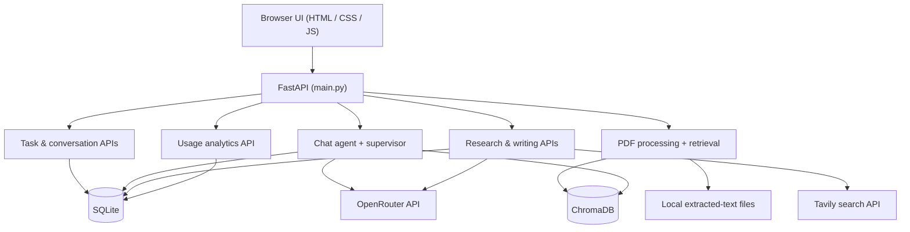
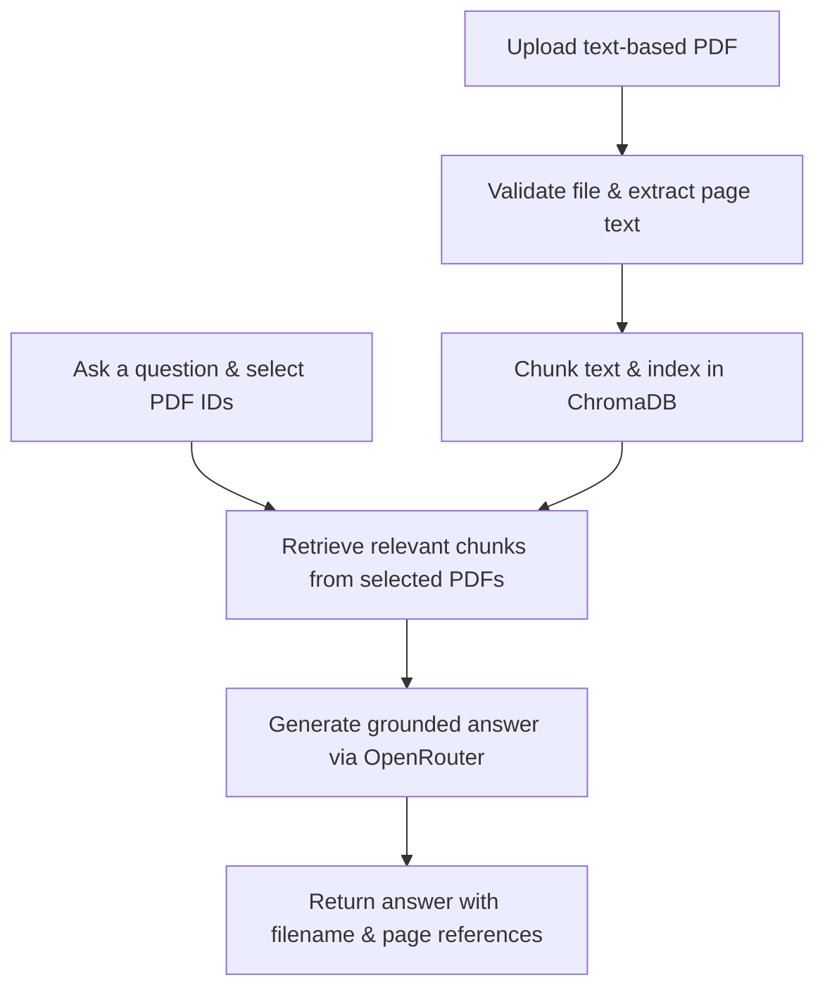

# TaskFlow AI — System Architecture

TaskFlow AI is a **local-first, single-user FastAPI application**. Its HTML/CSS/JavaScript frontend and Python API run on the same localhost origin. External services are used only for AI model calls (OpenRouter) and web search (Tavily).

## High-level architecture

## Main request flows

| Feature | Request path | How it works |
| --- | --- | --- |
| **Tasks** | `/api/tasks/` | FastAPI validates input and reads/writes SQLite. The dashboard uses the same task data. |
| **AI chat** | `/chat` | Loads the selected conversation context, routes the request through the agent/supervisor, calls OpenRouter when needed, and records available usage metadata. |
| **PDF RAG** | `/documents/` + `/chat` | `pypdf` extracts page text; `rag_store.py` chunks and indexes it in ChromaDB. Retrieval is scoped to the selected document IDs, and answers include source/page references. |
| **Web research** | `/api/research/search` | Tavily supplies search results. The backend filters sources, asks an OpenRouter model to summarize the retrieved snippets, and saves the result in SQLite. |
| **Writing** | `/api/writing/` | Generates or revises drafts with OpenRouter; saves drafts in SQLite and exports TXT, DOCX, or PDF locally. |
| **Analytics** | `/api/analytics/overview` | Aggregates previously recorded token usage and estimated costs from SQLite. The analytics endpoint does not call a model. |

## PDF question-answering flow

The PDF pipeline currently supports text-based PDFs up to **5 MB** per file; it does not perform OCR on scanned pages.

## Data and security boundaries

- **Local data:** tasks, conversations, drafts, research history, and usage records use SQLite; extracted PDF data and ChromaDB indexes stay on the same machine.
- **Secrets:** `backend/.env` contains local API keys and is excluded from Git. Keys must not be embedded in frontend code or committed to a public repository.
- **Localhost:** the development server binds to `127.0.0.1`. Same-origin/Host checks provide local browser protections but are **not** multi-user authentication.
- **External calls:** OpenRouter and Tavily require Internet access and may incur charges. Reported model costs are estimates, not invoices.
- **Scope:** this is a local single-user application. Hosting it publicly would first require authentication, user isolation, rate limiting, and other security work.
